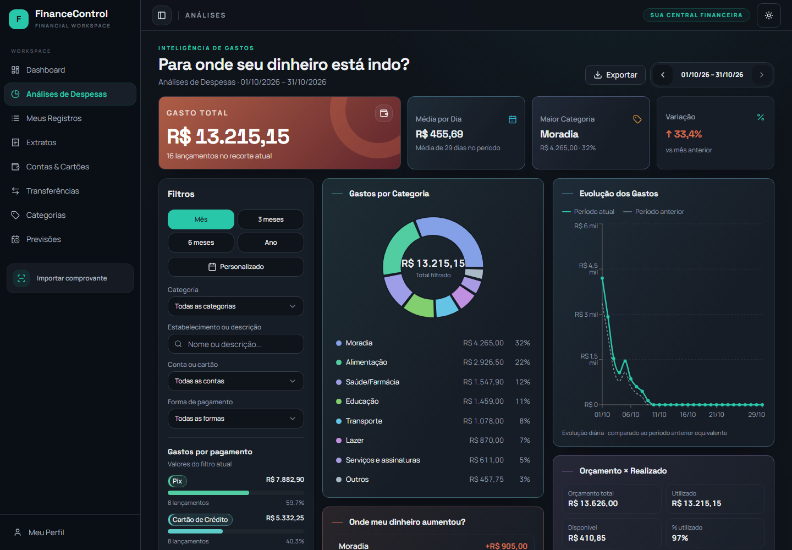
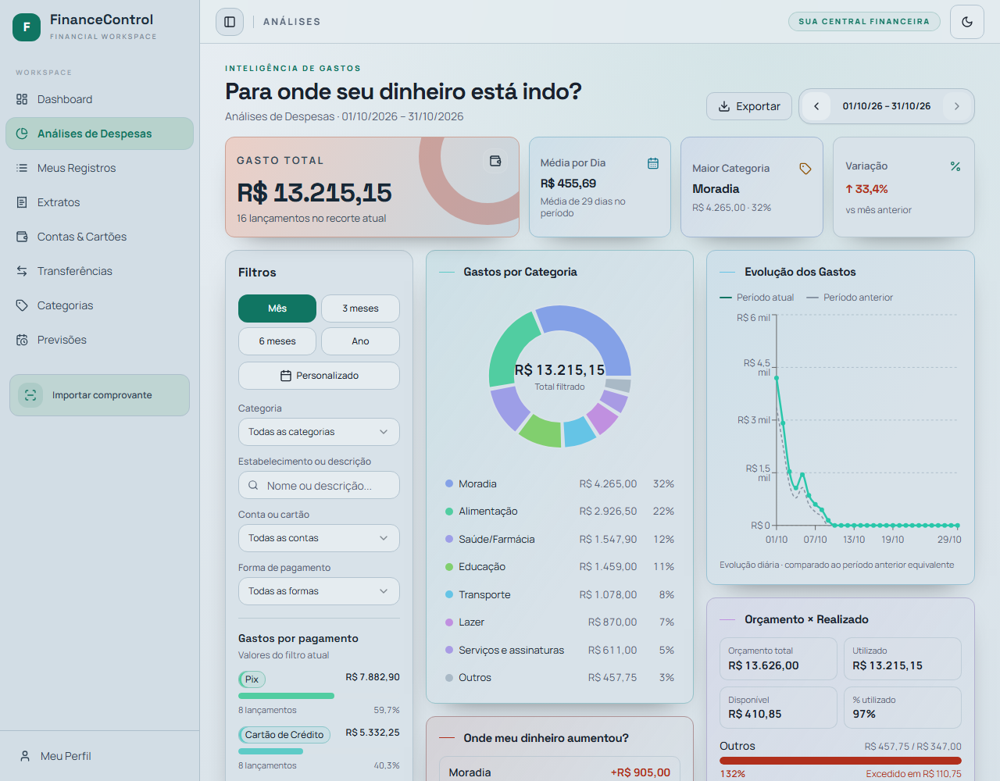

# Análises de Despesas — três colunas independentes

Atualização da **PR #50**, conforme a organização definida pelo proprietário. **Aguardar aprovação visual explícita; não integrar nem publicar.**

## Organização

Os indicadores permanecem acima das colunas. No desktop (1440 e 1280 px), a área seguinte é formada por três pilhas independentes:

| Esquerda, mais estreita | Centro | Direita |
|---|---|---|
| Filtros, incluindo Gastos por pagamento | Gastos por Categoria | Evolução dos Gastos |
| Transações do Período | Onde meu dinheiro aumentou? | Orçamento × Realizado |
| | Destaques do Período | |

Cada pilha usa crescimento natural e espaçamento de 16 px entre cards, sem linhas compartilhadas que dependam da altura das outras colunas. A evolução usa uma área proporcional à própria largura para permanecer legível sem depender da altura do donut ou dos filtros. As listas crescem sem rolagem interna.

Em telas pequenas, a leitura fica em uma coluna: filtros quando abertos, categorias, evolução, variações, orçamento, destaques e transações. A navegação usa a rolagem vertical da página.

A preparação dos dados financeiros, cálculos, filtros, séries, cores, exportação e regras dos gráficos foi preservada. O Ranking de Gastos permanece removido. Nenhum outro módulo ou banco foi alterado.

## Capturas reais para aprovação

Capturas do Chromium com a página e o AppLayout reais, menu, cabeçalhos, filtros e temas. Somente os provedores usam dados sintéticos: oito categorias, 16 transações do mês e oito anteriores, com orçamentos. As requisições ao Supabase foram bloqueadas. Não foram usados dados de produção. Celular validado por viewport, sem aparelho físico.

| Tela | Tema escuro | Tema claro |
|---|---|---|
| Desktop 1440 px — página inteira | [Abrir captura](candidate-1440-dark.png) | [Abrir captura](candidate-1440-light.png) |
| Desktop 1280 px — página inteira | [Abrir captura](candidate-1280-dark.png) | [Abrir captura](candidate-1280-light.png) |
| Celular — página inteira | [360 px](candidate-360-dark.png) | [390 px](candidate-390-light.png) |

### Área visível em 1440 px

### Área visível em 1280 px

## Validação

- Capturas e verificações em 1440, 1280, 768, 390 e 360 px, em ambos os temas.
- No desktop, posição de todos os sete cards e espaçamento de 16 px conferidos em cada coluna, inclusive transações logo após filtros e orçamento logo após evolução.
- No celular, ordem de leitura em uma coluna verificada.
- Sem overflow horizontal, textos ultrapassando os cards ou rolagem vertical interna artificial nos cenários avaliados.
- Todos os oito itens de categoria e os 16 lançamentos preservados.
- **28 testes da página aprovados**, incluindo filtros, comparação e exportação. O teste de organização foi atualizado para conferir os três agrupamentos definidos.
- **TypeScript app/node, lint dos dois arquivos alterados e build aprovados.** O lint global não foi repetido; problemas antigos de outros arquivos continuam fora do escopo.
- [Medições completas](measurements.json).

Arquivos funcionais alterados: `src/pages/ExpenseAnalytics.tsx` e seu teste. Os demais arquivos são evidências visuais atualizadas desta mesma PR.
