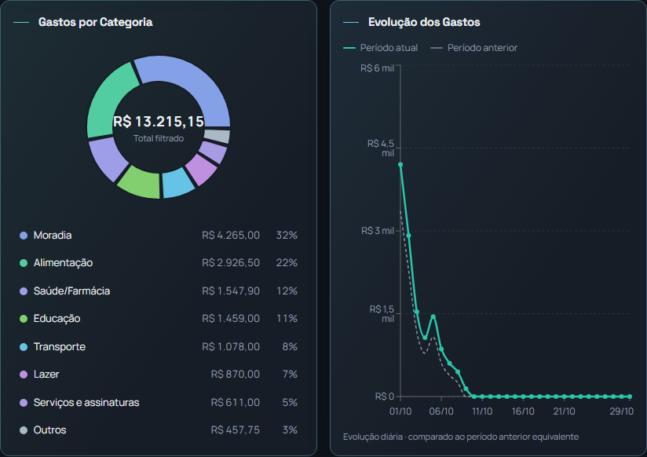
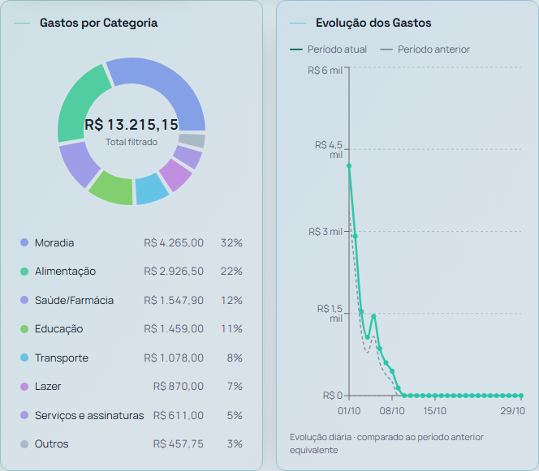

# Restauração da composição anterior à PR #48

**Proposta para aprovação visual. Não integrar nem publicar sem autorização explícita.** A proposta da PR #49 foi rejeitada e não faz parte desta branch.

A estrutura de `src/pages/ExpenseAnalytics.tsx` foi estudada e recuperada diretamente do commit `5dbdb42`, anterior à PR #48 e posterior à remoção do Ranking de Gastos. Os gráficos voltam a compartilhar a mesma linha no desktop, com donut acima da legenda e evolução na coluna ao lado. Os cards inferiores retornam à grade original de duas colunas. Em telas menores, os gráficos e os cards são empilhados.

As únicas diferenças em relação àquela referência são a retirada das posições explícitas de linha/coluna dos cards inferiores, a retirada dos limites de rolagem interna das listas e o ajuste da margem da lista de transações para não ultrapassar o card. Nenhum cálculo, filtro, exportação, dado, indicador, cor ou tema foi alterado. O Ranking de Gastos permanece removido.

## Capturas completas para aprovação

Todas as imagens são capturas reais do Chromium com os componentes da aplicação renderizados localmente: página, AppLayout, menu, cabeçalhos, filtros, navegação móvel e temas. Os provedores usam dados sintéticos (8 categorias, 16 transações no mês e 8 anteriores, com orçamentos). As requisições ao Supabase foram bloqueadas. Não foram usados dados de produção. A validação móvel foi feita por viewport, sem aparelho físico.

| Tela | Tema escuro | Tema claro |
|---|---|---|
| Desktop 1440 px — página inteira | [Abrir captura](candidate-1440-dark.png) | [Abrir captura](candidate-1440-light.png) |
| Desktop 1280 px — página inteira | [Abrir captura](candidate-1280-dark.png) | [Abrir captura](candidate-1280-light.png) |
| Celular | [360 px](candidate-360-dark.png) | [390 px](candidate-390-light.png) |

Referência anterior à PR #48: [1440 px](reference-1440-dark.png) e [1280 px](reference-1280-dark.png).

### Gráficos em 1440 px

### Gráficos em 1280 px

## Comparação com a estrutura original

Com os mesmos dados e a mesma largura, os gráficos recuperaram exatamente as dimensões da referência:

| Medição | Referência 1440 | Proposta 1440 | Referência 1280 | Proposta 1280 |
|---|---:|---:|---:|---:|
| Diâmetro do donut | 184 px | 184 px | 184 px | 184 px |
| Área da evolução | 462 px | 462 px | 445 px | 445 px |
| Gráficos lado a lado | Sim | Sim | Sim | Sim |
| Listas com rolagem interna | 3 | 0 | 3 | 0 |

A evolução acompanha a altura natural da composição, como antes da PR #48; não foi introduzida uma nova altura fixa para o desktop.

## Validação

- Capturas e verificações em 1440, 1280, 768, 390 e 360 px, nos dois temas; tema efetivo conferido no elemento raiz.
- Desktop: gráficos na mesma linha, com larguras iguais; variações e orçamento em duas colunas.
- Celular/tablet de 768 px: gráficos empilhados naturalmente.
- Sem overflow horizontal, textos ultrapassando os cards ou rolagem vertical interna nas listas nos cenários avaliados.
- 28 testes existentes da página aprovados, incluindo filtros múltiplos, comparação e exportação.
- TypeScript app/node, lint da página modificada e build aprovados. O lint global não foi repetido: os problemas preexistentes de outros arquivos registrados na revisão anterior estão fora deste escopo.
- [Medições completas](measurements.json).

O único arquivo funcional alterado é `src/pages/ExpenseAnalytics.tsx`; os demais arquivos são evidências para aprovação visual.
