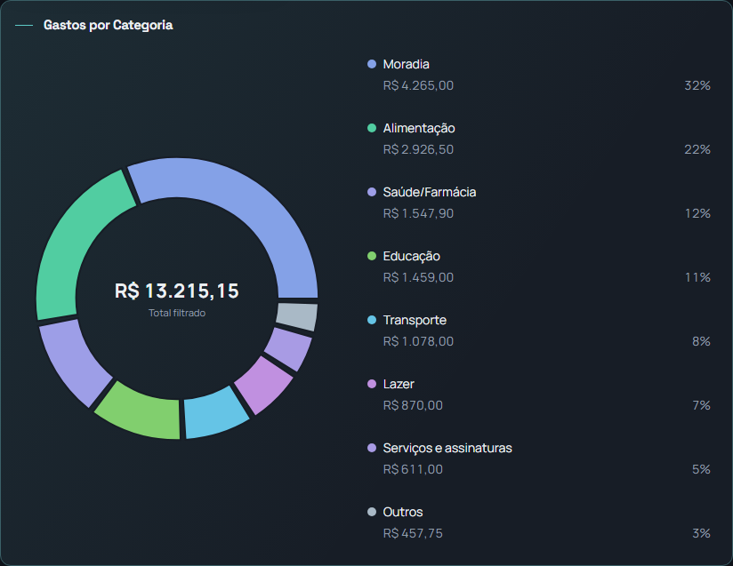
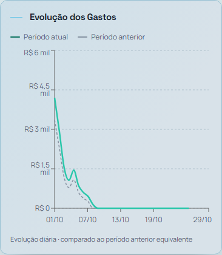

# Análises de Despesas — proposta para aprovação visual

Referências: anterior à PR #48 (`5dbdb42`) e PR #48 (`c969b91`). Esta proposta aguarda aprovação do proprietário. **Não integrar nem publicar automaticamente.**

## Composição proposta

- Cada gráfico usa a largura disponível ao lado dos filtros, com evolução abaixo da distribuição.
- Donut maior, centro ampliado e tipografia responsiva para o total filtrado.
- Legenda completa ao lado do donut no desktop e abaixo em telas menores; o card cresce com a lista.
- Evolução com 460 px de área no desktop, 380 px no tablet e 300 px no celular.
- Variações, orçamento e transações crescem naturalmente, sem limites de altura ou rolagem interna. Transações ocupam a largura inteira abaixo dos resumos.
- Cálculos, cores, filtros, indicadores, exportação, dados e limites de quantidade existentes permanecem no mesmo código. O ranking permanece ausente.

## Capturas reais da renderização local

Capturadas com Chromium, componentes reais de `ExpenseAnalytics`, `AppLayout`, menu, cabeçalhos, navegação móvel, estilos e `AppThemeProvider`. Somente os provedores de dados e o detalhe da transação foram substituídos por dados sintéticos: 8 categorias, 16 transações atuais e 8 anteriores, incluindo orçamentos e comparação. Requisições ao Supabase foram bloqueadas no navegador. Nenhuma conta ou informação financeira real foi usada.

São capturas de navegador, não imagens geradas. Mobile validado por viewport, sem aparelho físico. As imagens de página inteira mantêm os elementos fixos de navegação; no navegador também foi verificado que o último lançamento fica acessível acima da navegação móvel ao rolar até ele.

### Comparação em 1440 px, com os mesmos dados

| Versão | Diâmetro do donut | Área de evolução | Listas com rolagem interna |
|---|---:|---:|---:|
| Antes da PR #48 | 184 px | 462 px, dependente da altura do card vizinho | 3 |
| PR #48 | 198 px | 280 px | 4 |
| Proposta | 319 px | 460 px | 0 |

[Antes da PR #48](before-1440-dark.png) · [PR #48](current-1440-dark.png) · [Proposta](candidate-1440-dark.png)

### Desktop

[Página completa — 1440 px, escuro](candidate-1440-dark.png) · [Página completa — 1280 px, claro](candidate-1280-light.png) · [Donut em tema claro](category-1440-light.png)

### Tablet e celular

[Tablet — 768 px, claro](candidate-768-light.png) · [Celular — 360 px, escuro](candidate-360-dark.png) · [Celular — 390 px, claro](candidate-390-light.png)

## Validação

- Capturas e verificações em **1440, 1280, 768, 390 e 360 px**, em temas claro e escuro; o tema efetivo foi conferido no elemento raiz.
- Sem rolagem vertical interna nas listas dos cards, overflow horizontal ou elementos de texto ultrapassando seus cards no cenário renderizado.
- Total central contido no espaço interno do donut; oito categorias e todos os lançamentos mantidos no DOM.
- Interação em 1440 e 360 px: combinação de dois itens em cada um dos três filtros, menu aberto ao selecionar, persistência ao mudar período, totais esperados, limpeza e abertura do último lançamento.
- **28 testes da página aprovados**, incluindo cenários existentes de filtros, comparação e exportação.
- **TypeScript app/node e build aprovados.**
- **Lint da página: aprovado, sem erros ou avisos.** Lint geral executado: **123 erros e 25 avisos**, com erros em 23 arquivos preexistentes e não modificados. Não foram corrigidos arquivos fora do escopo. As pastas locais de captura e a configuração temporária de Vitest foram excluídas dessa verificação.
- Medições de todos os tamanhos e temas: [measurements.json](measurements.json).

O único arquivo funcional alterado é `src/pages/ExpenseAnalytics.tsx`. Os demais arquivos desta proposta são evidências de revisão visual.
